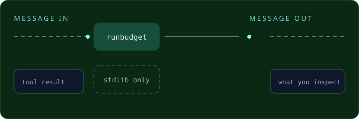

<p align="center">
  
</p>

<p align="center">
  <a href="https://pypi.org/project/runbudget/"></a>
  <a href="https://pypi.org/project/runbudget/"></a>
  <a href="https://pypi.org/project/runbudget/"></a>
  <a href="https://github.com/sandeshbagmare/runbudget/actions/workflows/ci.yml"></a>
  <a href="https://github.com/sandeshbagmare/runbudget/blob/main/LICENSE"></a>
  <a href="https://sandeshbagmare.github.io/runbudget/"></a>
  <a href="https://pypi.org/project/runbudget/"></a>
</p>

<h3 align="center">a per-run cost cap that warns before it stops</h3>
<p align="center"><em>Standard library only. No runtime dependencies. Python 3.9+.</em></p>

<p align="center">
  
</p>

## Install

```console
pip install runbudget
```

## Use

```python
from runbudget import Budget, BudgetExceeded, RunBudget

budget = RunBudget(
    budget=Budget(max_cost=2.00, max_tokens=500_000, max_steps=40),
    prices={"my-model": (0.50, 1.50)},   # dollars per million tokens
    warn_at=0.8,
)

while True:
    status = budget.status()
    if status.stopped:
        report_to_user(status.reason)     # "cost budget reached: $2.0000 of $2.0000"
        break
    if status.action == "warn":
        log(status.reason)                # "cost budget at 84%: $1.6900 of $2.0000"
    response = model(...)
    budget.add("my-model", response.input_tokens, response.output_tokens)
```

Or raise instead of returning a status:

```python
try:
    budget.check()        # also spelled budget.enforce()
except BudgetExceeded as error:
    error.reason          # "steps budget reached: 40 of 40"
```

At the end of a run:

```python
budget.spent, budget.tokens, budget.steps
budget.remaining          # Budget(max_cost=…, max_tokens=…, max_steps=…)
budget.breakdown()        # {"gpt-4o": {"steps": 3, "input_tokens": …, "cost": …}}
```

## Prices

`DEFAULT_PRICES` holds a small table (per million tokens, in dollars) so a first run works
without configuration: `gpt-4o`, `gpt-4o-mini`, `gpt-4.1`, `gpt-4.1-mini`, `claude-opus`,
`claude-sonnet`, `claude-haiku`, `gemini-2.5-pro`, `gemini-2.5-flash`, `llama` (free).

- override any entry with `prices={"gpt-4o": (2.00, 8.00)}`
- a model name is matched exactly first, then by prefix, longest first, so
  `gpt-4o-2026-01-01` uses the `gpt-4o` price
- an unknown model raises `KeyError` instead of quietly costing zero — the failure mode
  that makes a budget report say "you spent nothing"

Charges that are not model calls (a paid search API, a sandbox minute) go in with
`budget.add_cost(0.02, model="web_search")`.

## Rules

- All three limits are optional; `None` means unlimited.
- `warn_at` is a fraction of any limit; the status becomes `warn` at that point.
- The status is `ok` → `warn` → `stop`, and a `Status` is truthy until it is `stop`.
- Token counts are what the provider reported. Estimating input tokens before the call is
  a different problem; this library settles up after each response.
- Money is rounded to six decimals at each step, so cent-level totals stay readable.

## Limits

- The price table is a convenience, not a source of truth. Check it against your
  provider's page before trusting a monthly number.
- One currency (US dollars), one price per model — no caching discounts, no batch rates.
- It tracks a single run; for a daily or per-tenant cap, keep a long-lived object and
  call `reset()` when a run ends.

## Development

```console
python -m venv .venv
.venv/bin/pip install -e ".[test]"
.venv/bin/pytest
```

## License

MIT.
